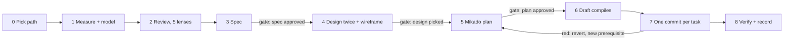

# Steps 0 to 1: pipeline, inventory, measure and model

Recovered verbatim on 2026-11-03 from SKILL.md at c18cc5d^ (the commit that moved this text out of SKILL.md did not write the file).

## The pipeline



| Path | When | Stages |
|---|---|---|
| A, answer | "how healthy is this?" | 0, 1, 2, report; optionally the [line pass](references/line-pass.md) over the hotspots |
| B, small fix | one file or finding, effort S, no interface changes | 0, 1, 2, 7, 8 |
| PR, one diff before merge | "review this PR", "code review", "before I merge" | 0, 1 on the diff, 2 on the lenses the diff touches, then the [PR review reference](references/pr-review.md): tests first, mutation check, change sizing, labelled findings, verdict. No gates; it edits nothing unless the owner asks for the fixes (then path B, with the merge-ready pass in that reference: update from base, parallel axes, a verifier per blocker, logical fix commits, PR body, never merge). |
| C, full | interfaces change, several files, a hotspot split, effort M or L | all, three gates |

Say the path in one line at the start. The owner may raise it; it never drops mid-job. Every
stage writes one numbered file into the job folder ([references/pipeline.md](references/pipeline.md)
holds the spec and plan templates). Anything over 100 lines goes to a file, and its point goes into chat in plain words, because the owner reads only the chat.

**THE REPO IS THE ONLY MEMORY EVERY SESSION SHARES.** Findings, plan and a kanban board
(`BOARD.md`) live in the job folder, committed and pushed, so any session on any account can
pick the job up at any moment. Every task commit carries the code, the card's move and a fresh
Handoff block together. Picking up: `git pull`, then
`bun ${CLAUDE_SKILL_DIR}/scripts/board.ts <job>/BOARD.md` (the job checks), then pull the next
card. Every card change is one call to the house **board** skill's script (`set --plan --done-when --verify --move ready --claim`; `move review --commit --note`), never a hand edit; its hook refuses one.
[references/tracking.md](references/tracking.md) has the board, the claim rule and the
handoff block.

**The progress bar follows the board.** Give the project the board skill's one-line
`scripts/progress.sh`; the progress bar reads its last line.

Copy this checklist into your reply and tick items off:

```
- [ ] 0. git pull; existing BOARD.md read if any; path said; project rules read; the owner's requirement sources found and read (notes, department analyses, client briefs)
- [ ] 0b. inventory.ts run; every row of 00-inventory.md walked: verdict, prior art, findings (board.ts fails on a blank row)
- [ ] 1. measure.ts and model.ts run once; 01-current.md with diagrams
- [ ] 2. Lenses run for the scope; line pass if asked; findings verified; 02-findings.md ranked; BOARD.md backlog (findings stay unplanned); pushed (A stops)
- [ ] 3. 03-spec.md written and self-reviewed              → GATE 1: owner approves
- [ ] 4. Prior art researched and saved; 04-target.md opens with `## Prior art`, then 2-3 designs, wireframe, comparison  → GATE 2: owner picks
- [ ] 5. 05-plan.md: Mikado graph, tasks, each with Done when and Verify  → GATE 3: owner approves; each task then moves to Ready with `--plan --done-when --verify`
- [ ] 6. Draft committed: new interfaces compile, behaviour unchanged
- [ ] 7. Pull a card, claim, push; one commit per task with board + handoff; green (red: revert, return to 5)
- [ ] 8. Re-measured, re-modelled, baseline ratchet + guard rule added, decision recorded
```

An approval covers only what was shown at that gate. Never run past a gate on an earlier yes.

**Ask each gate through the choices UI (AskUserQuestion) the moment it is reached, with the
content in the question in plain words.** A gate decides direction and scope; a defect found
along the way is fixed in the same turn without one. The owner reads only the chat, so a board line "awaits
the owner" is a stall nobody sees. Record in the Handoff `asked via the choices UI at <time>`
and, once answered, the answer. `board.ts` fails a Handoff that waits on the owner with no
such line.

## 0b. Inventory: every action, walked once

**A HOTSPOT RANKING DECIDES THE ORDER, NEVER THE SCOPE.** Sampling the busiest files skipped
a feature that every review then missed (2026-10-09: a ticket move built as two client
writes with a half-done state no mature POS has). So every job whose scope is a whole app, a
core, or "every feature" starts from a list of every action, made by a script so it is the same
every run:

```bash
bun ${CLAUDE_SKILL_DIR}/scripts/inventory.ts --sql <schema snapshot> --src apps --src packages --out <job>/00-inventory.md
```

One row per server function a client can call, and one per client hook that writes a table
directly, each with the hooks that call it and the screens that use them. Rerunning keeps what
reviewers wrote. Then walk the rows, hottest first, in batches an agent can finish (about ten
related rows: one feature):

1. Read the action end to end: the screen, the hook, the server function, the tables and
   triggers it writes, and the tests that pin it.
2. Compare it with how shipped systems do the same thing, from a saved prior-art note
   (`prior-art`, `backend-research`, or their saved folder): one transaction or several, which
   row is the truth, what a second device or a lost answer does, how it is undone.
3. Write the verdict in the row: **keep**, **refactor** (a shape that drifts, a second door, a
   half-state only a client-side sequence creates), **defect** (a wrong answer, with its
   sequence), or **dead** (nothing calls it). Give the prior-art path, or `n/a: <why>`, and the
   findings, each also filed in `02-findings.md`.

`board.ts` fails while any row has a blank verdict or prior-art cell. A row is never marked
from its name alone.

## 1. Measure and model

```bash
bun ${CLAUDE_SKILL_DIR}/scripts/measure.ts [path...]
bun ${CLAUDE_SKILL_DIR}/scripts/model.ts --focus=<path> <root-folders...>
```

Both write outside the repo (the temp folder; an `--out` inside the repo is redirected) and
print where. `measure.ts` writes `report.md` and `summary.json`: hotspots (commits × lines), import cycles, unused files,
exports and dependencies, copy-paste clones, and functions over the limits. `model.ts` writes
Mermaid graphs of the packages and of the scope's neighbourhood. Both need `git`, `bun` and,
on the first run, the network; [references/tools.md](references/tools.md) lists what they run and what to do when a
number looks wrong. Run them ONCE and hand the output to every lens; lenses never run heavy
checks of their own.

Scope by request:

| Asked for | Scope |
|---|---|
| Review a change, a PR, "before I merge" | `git diff <base>...HEAD`, plus the files it touches; method in [references/pr-review.md](references/pr-review.md) |
| Clean up a folder, a module, a feature | that path |
| "The codebase", "optimise everything" | the top 10 to 20 hotspots, never the whole tree |
| "The whole app", "audit it deeper", "every line" | every lens over the top 10 to 20 hotspots, the [line pass](references/line-pass.md) over the same files, and the data-layer lens over ALL database functions, policies and triggers (they are few lines each and nothing ranks them by churn) |
| "Wasted network calls", "layout shifts" | network and layout stability over the screens named, measured on a running app |
| "Why does this keep breaking?" | bandages over the files and their history, then the lens the root points to |

Then draw by hand what no tool can: a flowchart of each main flow through the scope, and a
state diagram wherever the code holds a real state machine. Rules for diagrams are in
[references/pipeline.md](references/pipeline.md).

